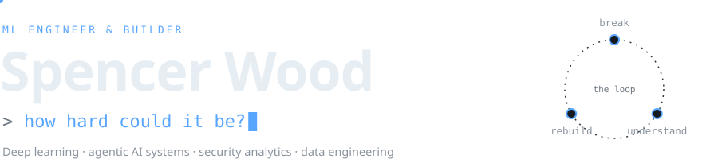
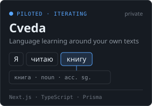
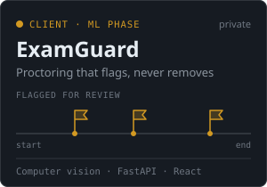
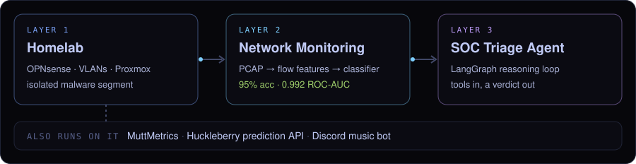

I've been taking things apart since I was a kid. I fried the motherboard of my first PC at 10, rebuilt it out of necessity, and that loop — break → understand → rebuild — never really stopped.

These days it shows up as a refusal to rent the layer below the one I need. I built a small enterprise network in a spare room to see what traffic actually does, put models on top of it, then services on top of those. Lately it has turned outward: businesses that have no data at all, where the thing they need isn't for sale. So I build the whole stack — the capture that creates the record, the schema that holds it, the models that read it, and the screens the people running the place actually touch.

On the way I taught an AI to land a rocket, rebuilt Shazam from scratch, and mapped where a fruit grows that nobody can farm. Half my life in the US, half in Europe. I still take the long route first — it's what makes the shortcuts obvious.

 

The longer version of all three

 

**[MuttMetrics](https://github.com/BOYSABIO/muttmetrics)** — I run the technical side of a dog-grooming salon: the site, the database, the backend, the interfaces the people there use, and the analytics on top. MuttMetrics is the layer underneath: owner and dog records, breed and service priors, and a model of how long the work really takes by breed, coat condition and service. It has run in production on its own server since November, with grooms logged from the salon floor. A groom that runs an hour long isn't a scheduling problem, it's a margin problem — and until it's measured nobody knows which jobs are paying for themselves.

**Cveda** 🔒 — A full product, built end to end and deployed: vocabulary tracking with morphology awareness, a document editor with click-to-translate, teacher–student collaboration, practice tools, analytics. Piloted with six tutors and their students, now iterating on what they actually did with it. Private because it's a product rather than a portfolio piece — which is the point.

**ExamGuard** 🔒 — A modular proctoring layer running alongside Safe Exam Browser. Client-side webcam inference — phone detection, gaze estimation, multi-person detection — producing timestamped flags with confidence scores. It never removes a student; it only flags. Ring-buffer clip upload keeps bandwidth sane, professors review and label in a dashboard, and those labels feed a fine-tuning loop.

 

**[Homelab](https://github.com/BOYSABIO/homelab)** · **[Network Monitoring](https://github.com/BOYSABIO/Network-Monitoring)** · **[SOC Triage Agent](https://github.com/BOYSABIO/SOC-Triage-Agent)** — three repos, one system, each built because the one below it made it possible. The homelab doubles as the deployment target for everything above. The interesting problem in the agent isn't security, it's architecture: when to gate, what context to fetch, how to make a model's output land as a decision rather than a paragraph.

 

| | |
|---|---|
| **[Huckleberry Habitat Model](https://github.com/BOYSABIO/Huckleberry-Habitat-Suitability-Model)**  Microsoft capstone · honors | The brief was *"monetize Microsoft GridMET climate data."* ~450GB of environmental data became a >90%-accuracy habitat model, then a service you can call: FastAPI `/predict` with per-tree confidence intervals, an MLflow registry, Docker, CI, hosted on the homelab. |
| **[Audio Fingerprinting](https://github.com/BOYSABIO/Audio-Fingerprinting-Matching-Pipeline)**  Shazam, rebuilt | Bronze → Silver → Gold lakehouse on Databricks, PySpark fingerprint hashing, confidence-scored matching. |
| **[Screen Snooper Detection](https://github.com/BOYSABIO/Screen-Snooper-Detection)**  computer vision | Catches someone reading over your shoulder in real time: YOLOv8 + MediaPipe gaze, a custom dataset labeled with Grounding DINO, primary-user exclusion. |
| **[Modular MLOps Pipeline](https://github.com/BOYSABIO/MLOps)**  where production started | A simple CNN rebuilt as a production system: modular steps, Hydra config, MLflow + W&B, containerized FastAPI serving, pytest and CI. |

 

**LLM-Lab** 🔒 &nbsp;
The pipeline the frontier labs run, rebuilt to understand it from the inside: data curation → pre-training → SFT → DPO → evals → inference optimization. Designed end to end, with a proxy ladder (1M → 100M params) for cheap ablations before anything big gets trained. It reached a working nanoGPT, then I parked it — it's the first one back when a slot frees.

 

 

plus LangGraph · Hugging Face · TRL · vLLM · MLflow · W&amp;B · PySpark · Databricks · Proxmox · OPNsense · Zeek · YOLOv8 · MediaPipe

<b>The full list</b>

 

                                                           

---

<b>Archives</b> &nbsp;·&nbsp; every other project, by domain

 

**Products**

- **[MuttMetrics](https://github.com/BOYSABIO/muttmetrics)** — the data and prediction layer for a working dog grooming salon; capture-first design, Postgres + FastAPI
- **Cveda** 🔒 — AI-assisted platform for tutors and students; Next.js, Prisma, Neon, Vercel
- **ExamGuard** 🔒 — proctoring layer for Safe Exam Browser; human-in-the-loop review, fine-tuning flywheel
- **[Discord Music Bot](https://github.com/BOYSABIO/discord-music-bot)** — self-hosted; Lavalink v4, Riffy, Docker Compose, deployed to its own homelab container

**Machine Learning & AI**

- **LLM-Lab** 🔒 — full model pipeline from scratch: curation, pre-training, SFT, DPO, evals, inference optimization *(parked)*
- **[Huckleberry Habitat Suitability Model](https://github.com/BOYSABIO/Huckleberry-Habitat-Suitability-Model)** — Microsoft capstone, ~450GB GridMET data, honors; extended into a deployed FastAPI service with MLflow registry, Docker, CI, homelab hosting
- **[Predicting Hotel Cancellations](https://github.com/BOYSABIO/Hotel-Cancellations-Prediction-Model)** — ensemble ML with feature engineering and optimization
- **[CO₂ Emissions Forecast](https://github.com/BOYSABIO/CO2-Emission-Forecast-Model)** — time-series forecasting of global flight emissions

**Systems & Security**

- **[Homelab](https://github.com/BOYSABIO/homelab)** — OPNsense, VLANs, Proxmox, IDS/IPS, isolated malware testing. Foundation and deployment target for everything above.
- **[Network Monitoring & Traffic Analysis](https://github.com/BOYSABIO/Network-Monitoring)** — PCAP → flow features → ML/DL classifier → ndjson; feeds the triage agent
- **[SOC Triage Agent](https://github.com/BOYSABIO/SOC-Triage-Agent)** — LangGraph agent: alert gating, case briefs, tool-calling reasoning loop, structured verdicts

**MLOps & Data Engineering**

- **[MNIST MLOps Pipeline](https://github.com/BOYSABIO/MLOps)** — modular pipeline steps, Hydra config, MLflow + W&B, containerized FastAPI serving, pytest + CI
- **[Audio Fingerprinting & Matching](https://github.com/BOYSABIO/Audio-Fingerprinting-Matching-Pipeline)** — Shazam-inspired at scale: Bronze → Silver → Gold lakehouse on Databricks, PySpark fingerprint hashing, confidence-scored matching

**Computer Vision**

- **[Pool Detection CNN](https://github.com/BOYSABIO/Pool-Detection-CNN)** — YOLO on satellite imagery, with oriented bounding boxes that rotate to fit pools of any shape
- **[Screen Snooper Detection](https://github.com/BOYSABIO/Screen-Snooper-Detection)** — real-time detection of someone reading your screen; YOLOv8 + MediaPipe gaze, custom dataset labeled with Grounding DINO, primary-user exclusion
- **[Image to ASCII](https://github.com/BOYSABIO/Image-to-Ascii)** — image → ASCII art converter, built because the manual process annoyed me

**Quantitative Finance**

- **[Stock Analysis & Prediction Dashboard](https://github.com/BOYSABIO/Stock-Analysis-Prediction-Dashboard)** — real-time analysis and prediction (Streamlit)
- **[Asset Price Path Simulator](https://github.com/BOYSABIO/Asset-Price-Path-Sim)** — Bachelier and Samuelson models
- **[ARCH/GARCH Volatility Modeling](https://github.com/BOYSABIO/OM-group-project-2)** — volatility models on CrowdStrike data

**Reinforcement Learning**

- **[Lunar Lander & Car Racing](https://github.com/BOYSABIO/DQN-DDQN-Gymnasium)** — DQN and DDQN agents on Gymnasium control tasks

🔒 = private repository. Happy to walk through any of these in a conversation.

<b>Notes</b> &nbsp;·&nbsp; coursework and study notes, in public

 

- **[MSc Data Science — IE University](https://github.com/BOYSABIO/IE-University)** — coursework and academic projects
- **[CompTIA Security+ Notes](https://github.com/BOYSABIO/CompTIA-SecurityPlus-Notes)** — *in progress*

---

**Conviction comes from contact. Everything here is something I got into before I was ready.**

